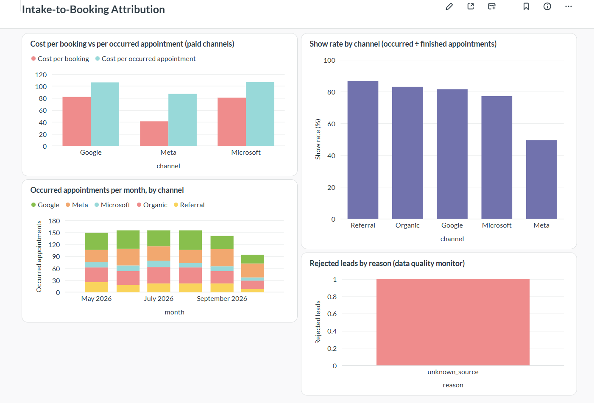
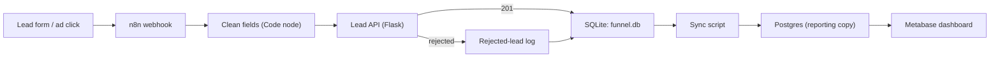
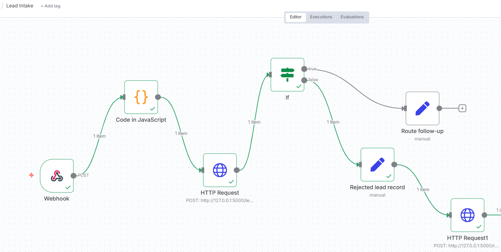

# Intake-to-Booking Attribution & AI Ops Pipeline

A portfolio project that follows a patient-style funnel end to end: **ad spend → lead → booking → occurred appointment**.
It shows how to connect marketing spend to the outcome that matters (appointments that actually happen), with
automation, a strict intake API, a reporting database and a dashboard.

> **All data is synthetic.** No real patient, company or ad-platform data is used. The channel results below come from
> assumptions built into the data generator. They are not research findings.



**What the simulated data shows:** Meta looks cheapest per *booking* (about $41 versus about $82 for Google), but only
49% of its booked appointments are attended (Google 82%, Microsoft 77%). Per *occurred* appointment the gap shrinks to about
$87 versus $106. This is why the project tracks cost per occurred appointment, not cost per booking.

Full write-up with decisions and mistakes: [docs/CASE_STUDY.md](docs/CASE_STUDY.md)

## Architecture



SQLite is the operational database the API writes to. Postgres is a reporting copy that Metabase reads
(Metabase has no official SQLite support that I could verify).

## The n8n workflow



Exported workflow: [n8n/lead_intake.json](n8n/lead_intake.json)

## What is built and what is only proposed

| Item | Status |
|------|--------|
| Synthetic funnel data generator and SQL schema | Built |
| Attribution SQL views (spend aggregated separately, so joins cannot inflate it) | Built |
| Lead intake API with a field allowlist (no contact or health fields accepted) | Built |
| n8n intake workflow with success and rejection paths | Built |
| Rejected-lead log (dead-letter table) | Built |
| Postgres reporting copy and Metabase dashboard (4 charts) | Built |
| 21 automated tests | Built |
| Deduplication, API-outage handling, appointment sync, ad-spend ingestion | **Proposed** as engineering specs, not built |
| Staff knowledge assistant with privacy guardrails, Matomo event design | **Planned**, not yet built |

Backlog: [docs/automation_backlog.md](docs/automation_backlog.md)
Specs: [SPEC-001](specs/SPEC-001_lead_deduplication.md) · [SPEC-002](specs/SPEC-002_ad_spend_ingestion.md) · [SPEC-003](specs/SPEC-003_appointment_status_sync.md) · [SPEC-004](specs/SPEC-004_api_unavailable_handling.md)
Dashboard export: [PDF](docs/Metabase%20-%20Intake-to-Booking.pdf)

## Quick start (Windows PowerShell)

Requires Python 3.12, Node.js with n8n, and Docker Desktop.

```powershell
python -m venv venv
.\venv\Scripts\Activate.ps1
pip install -r requirements.txt

python src/generate_data.py      # builds data/funnel.db (synthetic)
python src/build_views.py        # creates the SQL views
pytest -v                        # 21 tests

python src/lead_api.py           # leave running (127.0.0.1:5000)
```

Reporting stack (second terminal):

```powershell
Copy-Item .env.example .env      # then edit .env and set your own password
docker compose up -d
python src/sync_to_postgres.py   # copies data into Postgres
```

Then open Metabase at http://localhost:3000 and add a PostgreSQL database with host `postgres`, port `5432`,
database `reporting`, user `itb` and the password from `.env`. The four dashboard queries are in
[sql/dashboard_queries.sql](sql/dashboard_queries.sql).

n8n: run `n8n start`, open http://localhost:5678, import `n8n/lead_intake.json`, and test with the webhook test URL.

## Design decisions

- **Privacy by design:** the API rejects any field outside a short allowlist, so contact details and health information cannot enter the system.
- **Spend fan-out guard:** spend and funnel counts are aggregated separately before joining; a test checks that totals still match the source.
- **Honest rates:** show rate counts only appointments with a final status, so future appointments are not treated as no-shows.
- **Operational vs reporting database:** the API writes to SQLite; Metabase reads a Postgres copy refreshed by a script that checks row counts and total spend.

## Limitations

- Simulated data only; channel behavior is assumed.
- October looks low on the dashboard because appointments after 31 October are still "scheduled".
- The system cannot recognize the same person twice because it deliberately stores no contact details.
- If the API is down, leads sent through n8n are lost today. This is documented in SPEC-004 and tested.
- Local, single-machine setup; not production-ready.

---
Author: Ahmad ([@emadaed](https://github.com/emadaed)) · More case studies and engineering logs: [portfolio](https://emadaed.github.io/digisuite/)
